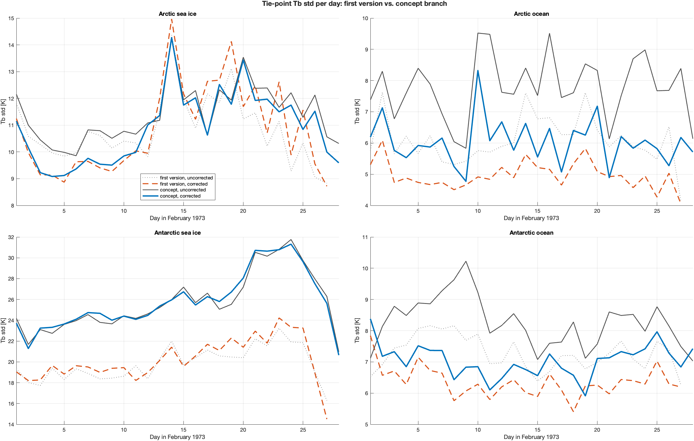
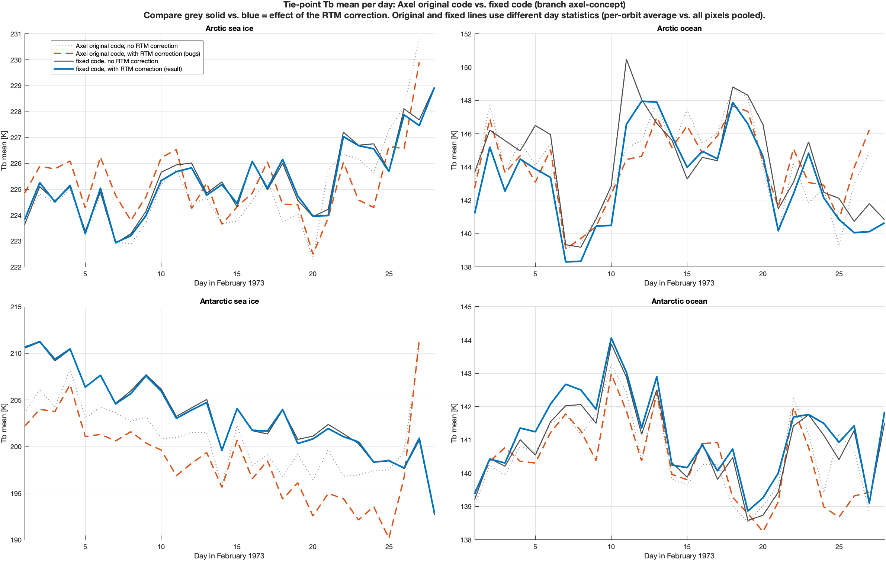

# Matlab: tie points and differential RTM correction (concept branch)

This branch (`axel-concept`) starts from Axel's first version (`Axel`, commit 9e76b44) and fixes the bugs found in the code review.
The list of every fix is in [CONCEPT_CHANGES.md](CONCEPT_CHANGES.md).

## How to run

The data folder must be next to `Matlab/`, as `../ESMR_colocated_filtered/` (312 NetCDF files, February 1973).

```matlab
cd Matlab
main                    % all 28 days -> results_concept/Uncorrected.mat, Corrected.mat
plotConceptComparison   % figures in results_concept/ + std table in the console
mainSingleFile          % one orbit: tie-point images + SIC maps
```

Pipeline per day: `readNetCDFStruct` → `filterTb` → `getTiePoints` → `poolStats` (uncorrected) → `applyRTM` → `poolStats` (corrected).

Correction: `Tb_corr = Tb + RTM(day-mean weather) − RTM(pixel weather)`. The pixel weather is V, W, Ts and Ti. L is not corrected (see finding 2).

## Findings

### 1. Bugs in the first version that changed the numbers

- **Cloud water sign.** `L = tcwv − tcw` is always ≤ 0 (down to −34 mm in file 1), which gives negative absorption and τ > 1. It is now `tcw − tcwv`. In the first version this pulled the corrected Antarctic ice tie point 3–5 K below the uncorrected one.
- **Stale rows.** The per-file weather arrays were never reset between days. When a day had fewer files than the day before, rows from the previous day entered the day mean.
- **Day boundaries.** The hard-coded `day_indices` agree with the file names only up to day 5. From day 6 on they are off by 1–2 files (e.g. day 6 ends at file 73, not 74). Day 28 was skipped. Days are now read from the file names.
- **One missing class discarded the whole file.** If one class was missing, all four classes of that file were set to NaN. The Arctic-ocean class has no pixels in 5 of the first 40 files, so the ice classes of those files were lost as well.
- **Element-wise clamps.** In `esmr_rtm.m`, an `if` on a matrix only fires when every element is true. So the σ² cap was never applied, although the wind over the ocean tie points reaches 27 m/s (the cap applies above ≈ 19.5 m/s).
- **Scan filter.** `sum` without `omitnan` skipped every scan that contained at least one NaN pixel: 465 of 1691 scans in file 1.

Bugs without an effect on the numbers: the masks never worked (`isnan` on a logical mask is always false), and the AntIce class used the ArcIce mask. The result was not affected only because the tie-point Tb is already NaN outside the mask.

### 2. L must not be corrected per pixel

We tested putting the pixel L (`tcw − tcwv`) into the actual run. This made the ocean scatter worse, for example the Antarctic ocean on 1 Feb went from 7.1 K to 13.3 K.

Diagnosis on file 1, Antarctic ocean:

| ERA5 input | std of modelled ΔTb | correlation with measured Tb |
|---|---|---|
| V (tcwv) | 2.8 K | −0.03 |
| W (u10, v10) | 2.4 K | **0.38** |
| L (tcw − tcwv) | 3.1 K | −0.01 |
| Ts (sst) | 0.1 K | – |

The ERA5 clouds and water vapour do not match the 1973 scenes pixel by pixel. Only the wind has a signal. Therefore the day-mean L goes into both runs. This follows the paper (Sect. 4.1, "TB is not corrected for the cloud liquid water") and our own `report_notes/A6`. The design of the first version was right here; only the sign was wrong.

### 3. Result: std of the tie-point Tb, mean over 28 days [K]

| Class | First version, uncorr. | First version, corr. | Concept, uncorr. | Concept, corr. |
|---|---|---|---|---|
| Arctic sea ice | 10.81 | 10.85 | 11.40 | **10.88** |
| Arctic ocean | 6.08 | 4.96 | 7.78 | **6.03** |
| Antarctic sea ice | 19.84 | 20.20 | 25.76 | 25.82 |
| Antarctic ocean | 7.27 | 6.36 | 8.27 | **7.04** |

- **Over the ocean**, the correction lowers the std by 1.2–1.8 K. This is where the weather terms matter.
- **Over ice**, the correction changes the std very little. This is expected, because over ice only Ti matters (see B1 sensitivity).
- The first and the concept columns cannot be compared directly, because the day statistics are now computed differently (finding 4).




### 4. Day statistics: pool all pixels, do not average file statistics

The first version took the mean of the per-file means and the mean of the per-file stds. Two things go wrong with that: the spread *between* orbits is lost, and a file with 100 pixels counts as much as a file with 1000.

Day 3, Antarctic sea ice (11 files):

| | mean | std |
|---|---|---|
| Mean of the file values (first version) | 204.3 K | 17.8 K |
| All pixels pooled (concept) | 209.2 K | 23.1 K |

The per-file means range from 179 K to 224 K. The orbits with many pixels are the warm ones. Pooling explains the higher uncorrected values in the concept columns.

### 5. Open points

- **Antarctic sea-ice tie point.** A std of 23–31 K is too large for a consolidated-ice tie point. The cluster probably contains ice-edge or thin-ice pixels, and the orbits differ by up to 45 K. The ice selection (`getTiePoints.m`: SIC ≥ 0.8, 5×5 box) should be checked for the Antarctic, e.g. a stricter SIC threshold or a larger distance to the ice edge.
- **28 February** has only 1 file, so that day is noisy.
- **Kept on purpose:** `sic > 0.95 → 1` in `calculateSIC.m`.
