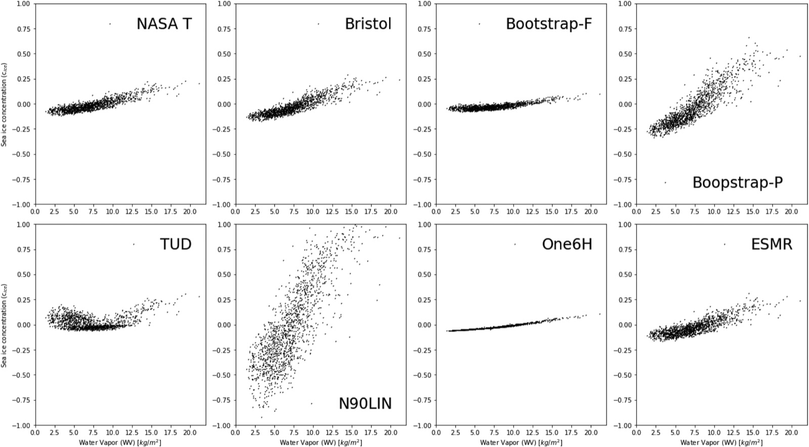
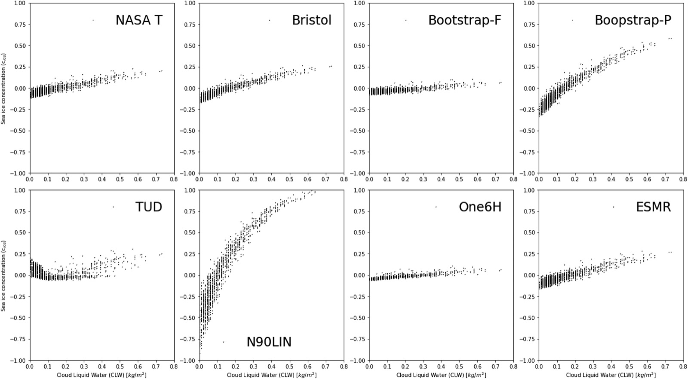
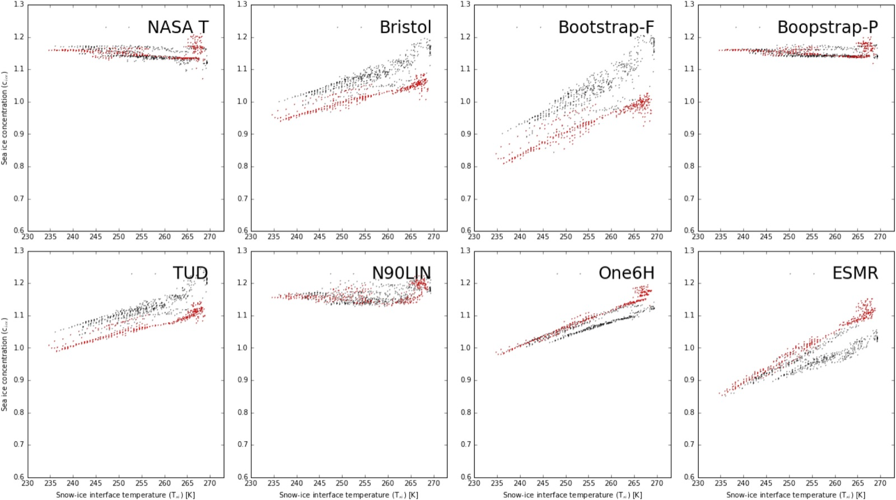
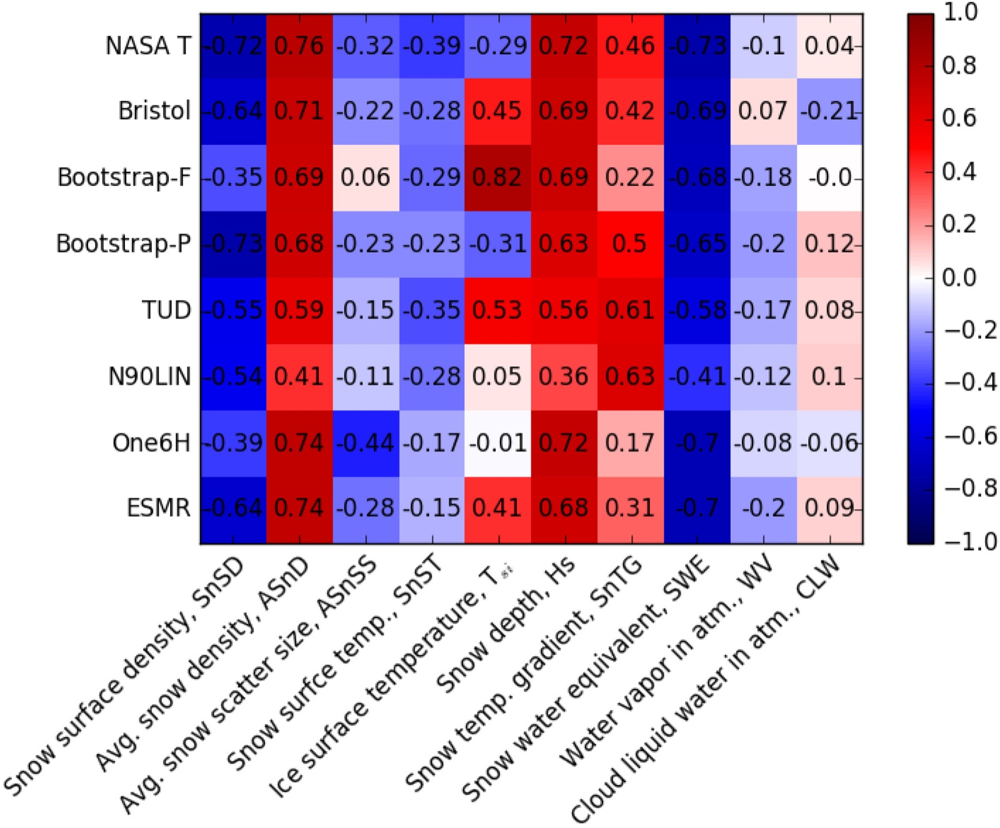
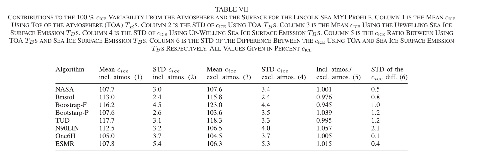
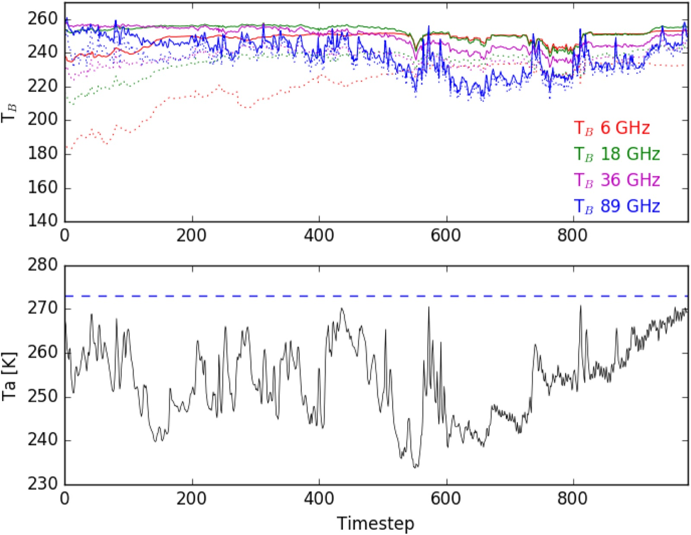
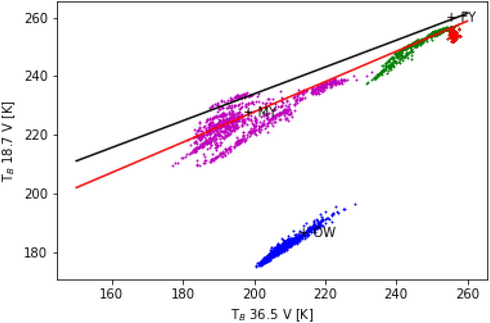

# How Tonboe et al. (2022) plot the sensitivity / geophysical noise

**Paper:** Tonboe, R. T., Nandan, V., Mäkynen, M., Pedersen, L. T., Kern, S., Lavergne, T., Øelund, J., Dybkjær, G., Saldo, R., Huntemann, M. (2022): Simulated Geophysical Noise in Sea Ice Concentration Estimates of Open Water and Snow-Covered Sea Ice. *IEEE JSTARS* 15, 1309–1326. doi:10.1109/JSTARS.2021.3134021
**Local copy:** `docs/literature/Tonboe/relevant/Simulated_Geophysical_Noise_in_Sea_Ice_Concentration_Estimates_of_Open_Water_and_Snow-Covered_Sea_Ice.pdf`
**Read:** 2026-11-16 (captions quoted from the PDF, layouts checked on the rendered pages)

## Set-up in one paragraph
- **Simulations:** top-of-atmosphere T_B from thermodynamic, emission and atmosphere models along three runs: open water in the Bellingshausen Sea, first-year ice in the Ross Sea, multi-year ice in the Lincoln Sea. Each run is a time series of model steps, and every step is one point in the plots.
- **Algorithms:** c_ice from 8 algorithms: NASA Team, Bristol, Bootstrap-F, Bootstrap-P, TUD, N90LIN, One6H, **ESMR**.
- **ESMR in the paper:** one channel, 18.7 GHz H, **fixed θ = 55°**. The paper calls this "a simplification compared to ESMR, which was an across-track scanner measuring at incidence angles between nadir and 63°".
- **No clipping:** c_ice may go below 0 % and above 100 %. Same as our raw SIC.
- **Wind is not studied:** conclusion 2 says "wind not investigated in this study".

## Figures, one by one

| Fig. | What is plotted | Layout and style | Caption (verbatim) |
|---|---|---|---|
| 1 | Flowchart of models and data | boxes and arrows | "Flowchart showing the sequence of models and input/output data." |
| 2, 4 | Simulated ice growth and snow accumulation (Ross Sea, Lincoln Sea) | time series | "Simulated ice growth and snow accumulation on the … site" |
| 3, 5 | Simulated T_B time series at 6.9/18.7/36.5/89 GHz | **upper panel:** T_B vs. time, colour = frequency (red 6.9, green 18.7, purple 36.5, blue 89), **solid = V-pol, dashed = H-pol**; **lower panel:** air temperature, dashed line at 0 °C | "Upper panel shows the simulated T_Bs at 6.9 (red), 18.7 (green), 36.5 (purple), and 89.0 (blue) GHz at V- (full-line) and H- (dashed-line) polarization …" |
| 6 | T_B 18V vs. T_B 36.5V (scatter) | ice runs and open water in one plot, ice lines and tie points (MYI, FYI, OW) marked | "Simulated TOA T_B 18V vs. the T_B 36.5V for the sea ice in the Lincoln Sea (purple), the Ross Sea (green/red), and open water in the Bellingshausen Sea (blue)…" |
| **7** | **100 % ice:** c_ice vs. snow–ice interface temperature T_si (Ross Sea FYI) | **2 × 4 small multiples, one panel per algorithm** (ESMR bottom right); black dots, **red = ice < 0.3 m thick**; x = T_si in K, y = SIC as a fraction around 1 | "c_ice vs. snow/ice interface temperature (T_si) for 100% young ice and FYI in the Ross Sea computed by eight different c_ice algorithms. Points where the ice thickness is less than 0.3 m are red." |
| **8, 9** | **Partial correlations** of c_ice with 10 parameters (Ross Sea / Lincoln Sea) | **heatmap**: rows = 8 algorithms, columns = 10 parameters (SnSD, ASnD, ASnSS, SnST, T_si, H_s, SnTG, SWE, **WV**, **CLW**); **diverging colour map blue–white–red, −1…+1**, **value printed in each cell**, colour bar on the right | "Partial linear correlations in the Ross Sea between c_ice and snow surface density (SnSD), … total water vapor in the atmosphere (WV), and total cloud liquid water in the atmosphere (CLW)." |
| **10** | **100 % ice:** c_ice vs. T_si (Lincoln Sea MYI) | same 2 × 4 layout as Fig. 7, x = T_si 230–275 K, y = SIC 0.6–1.3 (fraction); **red = points after a major mid-winter precipitation event** | "c_ice vs. T_si for 100% MYI in the Lincoln Sea calculated by eight different c_ice algorithms. Points after a major mid-winter precipitation event (at timestep 588) are red." |
| 11 | 100 % ice: c_ice vs. snow surface density | same 2 × 4 layout | "c_ice vs. snow surface density (SnSD) for 100% MYI in the Lincoln Sea for the eight different c_ice algorithms…" |
| **12** | **Open water:** c_ice vs. **total water vapour WV** | **2 × 4 small multiples, one per algorithm** (ESMR bottom right); small black dots; **x = WV 0–20 kg/m²**, **y = SIC −1.0…+1.0 (fraction), same y range in every panel** | "Sea ice concentration, c_ice, from simulated open water T_Bs vs. total water vapor in the atmosphere." |
| **13** | **Open water:** c_ice vs. **cloud liquid water CLW** | same layout; **x = CLW 0–0.8 kg/m²**, y = SIC −1…+1 | "Simulated open water c_ice vs. CLW content in the atmosphere. The stripes in the clusters are caused by the CLW data at 0.01 kg/m² quantization." |

**Tables used as part of the sensitivity result:**
- **Tables VI and VII** (100 % ice): mean and std of c_ice **with and without the atmosphere** (TOA T_B vs. surface emission T_B), their ratio, and the **std of the difference**, all in % c_ice.
  - This is an "exclusion" of the whole atmosphere, the same idea as our exclusion test.
  - ESMR, Lincoln Sea (Table VII): mean 107.8 % with the atmosphere vs. 106.3 % without; std 5.4 vs. 5.3 %; ratio 1.015; std of the difference 0.4 %.
- Table V: tie points (AMSR-E, NH).

## Examples (screenshots)
All images are from Tonboe et al. (2022), IEEE JSTARS 15, 1309–1326, doi:10.1109/JSTARS.2021.3134021, licensed under **CC BY 4.0**. They were extracted from the local PDF and scaled down; the content is unchanged. When one is reused in the report or slides, cite it as "from Tonboe et al. (2022), CC BY 4.0".

### Fig. 12 – open water: c_ice vs. water vapour (closest to our V sweep)

- **Layout:** 8 algorithms as 2 × 4 small multiples, ESMR bottom right.
- **Axes:** x = WV 0–20 kg/m²; y = SIC −1…+1 (fraction), the same in every panel.
- **How to read it:** the slope of each cloud is the sensitivity. ESMR rises from about −0.1 at 2 kg/m² to about +0.2 at 15–20 kg/m², which the paper calls "moderate".

### Fig. 13 – open water: c_ice vs. cloud liquid water (our L)

- Same layout; x = CLW 0–0.8 kg/m².
- The vertical stripes come from the 0.01 kg/m² quantisation of CLW (caption).

### Fig. 10 – 100 % ice: c_ice vs. snow–ice interface temperature (our Ti)

- Lincoln Sea multi-year ice. Red = after a mid-winter precipitation event.
- ESMR (bottom right) is clearly linear in T_si: 0.007 per K, i.e. 0.061 per 1σ (8.7 K). This matches our finding that over ice only Ti matters.
- Fig. 7 has the same layout for the Ross Sea first-year ice. Not included here.

### Fig. 8 – partial correlations of c_ice with 10 parameters (Ross Sea)

- Heatmap with 8 algorithms × 10 parameters, a blue–white–red scale from −1 to +1, and the value printed in each cell.
- ESMR row: strongest with snow density/depth/SWE (|r| ≈ 0.6–0.7) and T_si (0.41); WV −0.2, CLW 0.09.
- Fig. 9 is the same for the Lincoln Sea. Not included here.

### Table VII – c_ice with vs. without atmosphere (Lincoln Sea MYI)

- This is the paper's "exclusion" of the whole atmosphere.
- ESMR: std 5.4 % with the atmosphere vs. 5.3 % without; the std of the difference is only 0.4 %. So over ice the atmosphere hardly matters, as in our exclusion test for the Arctic ice.

### Context figures (style only)
| Fig. 3 – simulated T_B time series (Ross Sea) | Fig. 6 – T_B 18V vs. 36.5V with tie points |
|---|---|
|  |  |
| Colour = frequency, solid = V-pol, dotted = H-pol; air temperature below | Clusters per surface type, ice lines and tie points (FY, MY, OW) |

## How the numbers are derived (text, not figures)
- **Sensitivity = slope of a line fitted to each cluster** in Figs. 7/10/12/13, e.g. per kg/m² or per K.
- **Bias per 1σ = slope × 1 std of the parameter.** It is given in brackets after each algorithm.
  - Example, ice: "ESMR 0.007/K … The T_si standard deviation is 8.7 K … the ESMR can have c_ice biases of … 0.061".
  - Example, open water: "One6H (0.008/kg m⁻² and for one STD: 0.025)", "N90LIN (0.105/kg m⁻² 0.326)".
- **Units:** c_ice as a **fraction** in the figures (−1…1 or 0.7–1.3) and in the slopes; **percent** in Tables VI/VII.
- For ESMR over open water only a qualitative statement: "NASA Team, Bristol, TUD, and ESMR have moderate sensitivity" to WV and CLW. No ESMR slope is given in the text.

## Style summary (what to copy)
1. **Small multiples**, one panel per case, **with the same y range in every panel** so the slopes are directly comparable.
2. **x = geophysical parameter in physical units, y = SIC.** Raw scatter of the simulated points. The fitted line is not drawn; the slope is given in the text.
3. **Colour only to mark a subset** (thin ice, after a snowfall event). Otherwise black dots.
4. **Heatmap with printed values** for many parameters at once (partial correlations, −1…+1, blue–red).
5. **"Slope × 1σ"** as the summary number for each parameter.
6. **Atmosphere on/off comparison** in a table, in % c_ice.

## What this means for our figures
| Ours | Closest Tonboe figure | Difference |
|---|---|---|
| Sweep `B1d_sweep.png` (ΔT_B vs. input, model curves) | Figs. 12/13 (open water), Figs. 7/10 (ice) | We show smooth RTM curves for one ESMR-like case at 3 angles. Tonboe shows scatter of simulated runs for 8 algorithms at 55°. Our y is in K (+ % SIC), his is in SIC fraction. |
| Tornado `B1_tornado.png` (±1σ in % SIC) | the "slope × 1σ" numbers in the text | Same measure, but we show it as a figure. |
| Exclusion test `B1c_exclusion.png` | Tables VI/VII (atmosphere on/off) | We leave out **one** input at a time, on **real** 1973 data. He removes the whole atmosphere in a simulation. |
| — (not built) | Figs. 12/13 with **our real pixels** | Possible extra: scatter of the open-water SIC vs. ERA5 V, W, L, uncorrected vs. corrected, same y range in all panels. |
| — | Figs. 8/9 heatmap | Could show the partial correlation of SIC with V, W, L, Ts per hemisphere. Not built. |

**Cite in the report:**
- "geophysical noise" (title and term)
- the "sensitivity × 1σ" measure
- ESMR: "moderate sensitivity" to WV and CLW over open water; over ice, sensitive to T_si
- "wind not investigated in this study", so our wind results add something
- Do **not** compare the numbers directly: his ESMR is simulated at fixed 55°, ours is real 1973 data at 0–55.7°.
